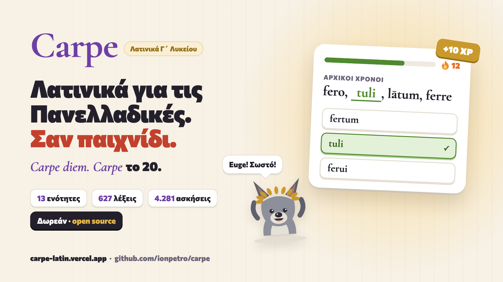

# Carpe

*Carpe diem. Carpe το 20.*

**Live:** https://carpe-latin.vercel.app (Vercel project `carpe-latin`)

**Open source** under the [MIT license](LICENSE). Free, and it will always be free. No account, no ads. The only thing we do is measure how it's used with [PostHog](https://posthog.com) (anonymous; session recordings hide anything typed) so we can make it better. Corrections to the Latin are very welcome: open an issue or a pull request.



**English in brief.** Carpe is a playful, Duolingo-style web app that teaches Latin to a Greek Γ΄ Λυκείου student sitting the Panhellenic exams (Λατινικά, Ομάδα Προσανατολισμού Ανθρωπιστικών Σπουδών, June 2027). It is a sibling of [Skepsis](https://github.com/ionpetro/skepsis) and keeps its tricks: guess-first openers, build-from-tiles, match pairs, a yes/no sorting game, spaced review, streaks with freezes and no hearts, badges, a speed round, a mascot with moods. The UI and every explanation are in modern Greek with the terminology Greek schools use; the Latin follows the school textbook and the Τζάρτζανος grammar. Plain JavaScript, no framework, one HTML file. Run `npm test && npm run build`, then serve `app/vercel/`. The rest of this file is in Greek, for the people who will use and extend it.

---

## Ανοιχτός κώδικας και η οικογένεια

Το Carpe είναι δωρεάν και ανοιχτού κώδικα (MIT). **Αν σε βοηθά, [δώσε του ένα αστέρι στο GitHub](https://github.com/ionpetro/carpe)**: ένα αστέρι βοηθά κι άλλους να το βρουν. Διορθώσεις και pull requests είναι ευπρόσδεκτα.

Το Carpe είναι μία από τέσσερις δωρεάν εφαρμογές ανοιχτού κώδικα, φτιαγμένες με τον ίδιο τρόπο (σύντομα καθημερινά μαθήματα, επανάληψη σε διαστήματα, χωρίς λογαριασμό):

- **Skepsis**: οι ελληνικές ρίζες που κρύβονται στα αγγλικά. [Παίξε](https://skepsis-greek.vercel.app) · [GitHub](https://github.com/ionpetro/skepsis)
- **Carpe** (αυτή εδώ): Λατινικά για τις Πανελλαδικές. [Παίξε](https://carpe-latin.vercel.app) · [GitHub](https://github.com/ionpetro/carpe)
- **Gnothi**: Αρχαία Ελληνικά για τις Πανελλαδικές. [Παίξε](https://gnothi-greek.vercel.app) · [GitHub](https://github.com/ionpetro/gnothi)
- **Objection**: προετοιμασία για τις εξετάσεις δικηγόρων των ΗΠΑ. [Παίξε](https://objection-bar.vercel.app) · [GitHub](https://github.com/ionpetro/objection)

## Τι είναι

Μια εφαρμογή για το κινητό και τον υπολογιστή που κάνει τα Λατινικά των Πανελλαδικών παιχνίδι: τρία με πέντε λεπτά τη φορά, με τις εκφωνήσεις ακριβώς όπως τις βάζει η επιτροπή («τη γενική πτώση, στον άλλο αριθμό», «X: είναι … στο …», «να μετατρέψετε την ενεργητική σύνταξη σε παθητική»). Μασκότ ο **Remo**, ένα λυκόπουλο με δάφνινο στεφάνι. Οι πόντοι είναι **δηνάρια**, ο γρήγορος γύρος είναι το **Κολοσσαίο**, οι τίτλοι είναι ρωμαϊκοί βαθμοί (Tiro, Miles, Centurio…).

Τι περιέχει (13 μονάδες στη «Via Appia», 4.281 κάρτες):

| Θέμα εξέτασης | Μονάδες | Τι εξασκείς |
|---|---|---|
| Α1 Μετάφραση (20) | u2, u5, u9 | Οι προτάσεις-κλειδιά των κειμένων 16-50 με πλακίδια μετάφρασης, το λεξιλόγιό τους, «βρες στο κείμενο» |
| Β1 Εισαγωγή (10) | u12 | Σωστό/Λάθος, α/β/γ και αντιστοιχίσεις από την τράπεζα του υπουργείου και το σχολικό βιβλίο |
| Β2 Ετυμολογία (10) | u1 | Δάνεια και συγγενείς λέξεις, ο επίσημος κατάλογος ανά μάθημα, αντιστοίχιση 5 λατινικών σε 7 ελληνικές |
| Γ1 Ονόματα (15) | u3, u6 | Κλίσεις, γενική πληθυντικού (-ium/-um), παραθετικά, επιρρήματα, αντωνυμίες, τα παράξενα (vis, bos, castra, Romae) |
| Γ2 Ρήματα (15) | u4, u7 | Αρχικοί χρόνοι, οριστική/υποτακτική/προστακτική, αποθετικά, απαρέμφατα, μετοχές, γερούνδιο, γερουνδιακό, σουπίνο, περιφραστική συζυγία, ανώμαλα |
| Δ1 Συντακτικό (15) | u8, u10 | Η φόρμουλα «είναι … στο …» για πτώσεις, απαρέμφατο, μετοχή, γερούνδιο, σκοπό· δευτερεύουσες με αιτιολόγηση εκφοράς βήμα-βήμα (1+1+1+1+1 μονάδες) |
| Δ2 Μετατροπές (15) | u11 | Ενεργητική ↔ παθητική, ευθύς ↔ πλάγιος λόγος, μετοχή ↔ πρόταση, απόλυτη αφαιρετική, σκοπός με όλους τους τρόπους, υποθετικοί λόγοι, τόπος, απαγόρευση |
| Όλα | u13 | Παγίδες εκφώνησης και μορφολογίας, τι θέλουν να δουν οι βαθμολογητές, η μέρα της εξέτασης |

Πώς παίζεται:

- **Μάθημα** («μέρος»): ξεκινά με «Μάντεψε πρώτα» χωρίς βαθμό, μετά κάθε κάρτα διδάσκεται σε μια ανάσα και ρωτιέται αμέσως, μετά οι δύσκολες ερωτήσεις (τύπος με πλακίδια ή γραφή, αρχικοί χρόνοι σε θέσεις, αντιστοίχιση, ταξινόμηση, εφάρμοσε-τον-κανόνα σε άγνωστο τύπο), και στο τέλος ξαναέρχονται όσα έχασες. Λέξεις που έμαθες σε προηγούμενη μονάδα δεν ξαναδιδάσκονται· ρωτιούνται.
- **Επανάληψη**: κουτιά Leitner (1, 3, 7, 14, 30, 60 μέρες). Από τον Μάιο καμία επανάληψη δεν πέφτει μετά τις 7 μέρες πριν την εξέταση.
- **Θέμα της ημέρας**: κάθε μέρα της εβδομάδας ένα Θέμα (Δευ Γ1, Τρι Γ2, Τετ Δ1, Πεμ Δ2, Παρ Β1+Β2, Σαβ Α1, Κυρ μικτό) με τις πραγματικές του μονάδες. Ίδιο όλη μέρα.
- **Διαγώνισμα**: και τα 7 Θέματα σε μικρογραφία, 100 μονάδες, με ανάλυση ανά Θέμα στο τέλος.
- **Κολοσσαίο**: 20 δευτερόλεπτα, τρεις επιλογές, ένα λάθος και κλείνει η αρένα.
- **Λέξεις**: 25 κάρτες σε 2 λεπτά, κατευθυνόμενες από το «στο σχολείο είμαστε στο μάθημα N».
- **Τετράδιο λαθών**: ό,τι έχασες δύο φορές, με τα χειρότερα πρώτα.
- **Σερί**: τα Σαββατοκύριακα δεν το σπάνε, μία άδεια την εβδομάδα και μία κάθε 7 μέρες σερί (έως 2). Χωρίς καρδιές, χωρίς τιμωρίες.

Η αρχική οθόνη λέει πόσες μέρες μένουν και, ειλικρινά, τι ρυθμό θέλει όλη η διαδρομή: περίπου 700 μέρη των 4-5 λεπτών, δηλαδή γύρω στα 3,5 μέρη (15 λεπτά) τη μέρα από τον Νοέμβριο. Η ημερομηνία εξέτασης (Τετάρτη 2 Ιουνίου 2027, 08:30) προέρχεται από δημοσίευμα για το πρόγραμμα του υπουργείου και αλλάζει από τις ρυθμίσεις· επιβεβαίωσέ την τον Μάρτιο.

## Πώς τρέχει

```
npm test          # validator + έλεγχοι engine (node:test) σε κάθε μονάδα, ~20 δευτερόλεπτα
npm run validate  # αναφορά του validator για όλες τις μονάδες (0 errors απαιτούνται)
npm run build     # app/dist/index.html (ένα αρχείο) + app/vercel/ (site: app, /lexiko, /about, sitemap, manifest)
```

Τοπικά: `npm run build && python3 -m http.server 8765 --directory app/vercel` και άνοιξε `http://127.0.0.1:8765/`. Deploy: `npm run build && cd app/vercel && vercel deploy --prod` (με `POSTHOG_KEY` στο `app/.env`, που δεν μπαίνει στο git, φορτώνεται το PostHog· χωρίς αυτό, κανένα analytics). Η πρόοδος μένει στη συσκευή (`localStorage`, κλειδί `carpe:v1`). Το μόνο που στέλνουμε είναι ανώνυμα γεγονότα χρήσης στο PostHog (με `app = carpe`), για να βελτιώνουμε την εφαρμογή· οι καταγραφές συνεδριών κρύβουν ό,τι πληκτρολογείς.

Χρειάζεται μόνο Node (χωρίς εξαρτήσεις). Οι γραμματοσειρές (Nunito, Cormorant Garamond) φορτώνουν από το Google Fonts και έχουν fallback.

## Πώς είναι οργανωμένο το περιεχόμενο

```
app/
  src/units/u1.js … u13.js   μία μονάδα ανά αρχείο, απλά αντικείμενα JS (σχήμα: app/CONTENT_SCHEMA.md)
  src/units/u0_example.js    το παράδειγμα με όλα τα είδη καρτών (δεν μπαίνει στο build)
  src/engine.js              καθαρή λογική: ημερομηνίες, σερί, κουτιά, κατασκευή ερωτήσεων, Θέμα ημέρας, διαγώνισμα, Κολοσσαίο, τίτλοι
  src/app.js                 η διεπαφή στα ελληνικά (Remo, Via Appia, Λεξικό, Εγώ, οι renderers κάθε είδους ερώτησης)
  src/style.css, shell.html  ρωμαϊκή παλέτα, dark mode, πρώτα για κινητό
  tools/validate.js          ο validator του περιεχομένου
  test/                      content.test.js (κάθε μονάδα περνά τον validator, κάθε ερώτηση παίζεται) και engine.test.js
  build.mjs, site.mjs        build ενός αρχείου και το site για το Vercel
research/                    η έρευνα πίσω από το περιεχόμενο (βλ. Πηγές)
```

Τα 11 είδη καρτών: `word` (λέξη με αρχικούς χρόνους/γενική, γένος, ετυμολογία, παγίδα), `sentence` (πρόταση κειμένου με πλακίδια μετάφρασης, συντακτικές σημειώσεις, «βρες»), `form` (τύπος Γ1/Γ2 με κελί, αποδεκτές γραφές, πλακίδια, κανόνα), `rule` (κανόνας με 1-5 ερωτήσεις ελέγχου), `role` (Δ1α «είναι … στο …»), `clause` (δευτερεύουσα με είδος, λειτουργία, εισαγωγή, έγκλιση, χρόνο), `transform` (Δ2 μετατροπή με πλακίδια), `fact` (Β1), `hook` (Β2 ετυμολογία), `origin` (λατινικό ή όχι;), `trap` (παγίδα: λάθος → σωστό).

Κάθε κάρτα δηλώνει `status` (`book` ελέγχθηκε στο σχολικό βιβλίο ή τον Τζάρτζανο, `exam` από πραγματικό θέμα ή κλειδί, `general` καθιερωμένα Λατινικά εκτός σχολικών βιβλίων, `unsure` «προς έλεγχο» από άνθρωπο) και `src` (πού ελέγχθηκε). Η μαθήτρια βλέπει μόνο ό,τι έχει νόημα (π.χ. «Παν. 2024 Γ1», «Βικιλεξικό»)· ονόματα αρχείων της έρευνας κρύβονται. Οι εμφανίσεις σε θέματα (`exam: [2026]`) προέρχονται μόνο από θέματα που διαβάστηκαν (`research/pastpapers.md`). Δεν υπάρχουν εφευρεμένα ποσοστά.

Κανόνες γραφής: τα Λατινικά όπως τα τυπώνει το βιβλίο (με μακρά) σε ό,τι εμφανίζεται· οι απαντήσεις χωρίς μακρά (ο έλεγχος αγνοεί τόνους, κεφαλαία και στίξη, όχι όμως u/v και i/j). Ο validator απορρίπτει ελληνικά σε λατινικά πεδία και το αντίστροφο, ελέγχει ότι κάθε μετατροπή χτίζεται από τα πλακίδιά της (λέξη που επαναλαμβάνεται, π.χ. «aut … aut», θέλει δύο πλακίδια), ότι τα πλακίδια τύπου ενώνονται στην απάντηση, ότι οι λάθος επιλογές δεν συμπίπτουν με τη σωστή.

Για να προσθέσεις περιεχόμενο: αντέγραψε το σχήμα από το `u0_example.js`, γράψε στο αντίστοιχο `uN.js`, τρέξε `npm test`. Ιδέες με `transfer: true` ρωτιούνται «κρύες» («Νέο: εφάρμοσε τον κανόνα») χωρίς κάρτα διδασκαλίας.

## Πηγές

Όλα στο `research/` (η έρευνα έγινε 2026-11-01· τα αρχεία λένε τι διαβάστηκε ολόκληρο και τι όχι):

- `syllabus.md`: εξεταστέα ύλη 2027 (Υ.Α. 90176/Δ2/06-07-2026, ΦΕΚ Β΄ 4210), οδηγίες διδασκαλίας 2026-27, μορφή και ημερομηνία της εξέτασης.
- `pastpapers.md`, `passages-by-paper.json`, `morphology-past-items.json`: 35 θέματα 2000-2026 (Ιούνιοι, Επαναληπτικές, Ομογενών) και 3 κλειδιά, με μετρήσεις για το τι ζητείται κάθε χρονιά. Τα ακατέργαστα κείμενα των θεμάτων (`pastpapers-raw/`) μένουν εκτός git.
- `official-2026-27-etymology-by-lesson.txt`, `official-2026-27-literature-question-bank.txt`: ο επίσημος κατάλογος ετυμολογίας ανά μάθημα και η τράπεζα ερωτήσεων Εισαγωγής από τις οδηγίες του υπουργείου (τοπικά μόνο).
- `texts.md`, `vocab.md` + `vocab.jsonl`, `morphology.md`, `syntax.md`, `traps.md`, `derivatives.md` + `hooks.jsonl`: τα κείμενα 16-50, το λεξιλόγιο, η μορφολογία, το συντακτικό με το λεξιλόγιο των κλειδιών, οι παγίδες, τα δάνεια και οι συγγενείς λέξεις.
- `CURRICULUM.md`: ο σχεδιασμός των 13 μονάδων και το γιατί.
- `source-data/`: το σχολικό βιβλίο (Πασχάλης-Σαββαντίδης, Λατινικά Τεύχη Α΄-Β΄) και η Γραμματική Τζάρτζανου σε κείμενο, μόνο για έλεγχο, **ποτέ δημόσια** (πνευματικά δικαιώματα ΙΤΥΕ). Γι' αυτό και η εφαρμογή διδάσκει μόνο τις προτάσεις-κλειδιά κάθε κειμένου, όχι ολόκληρα τα κείμενα.
- `skepsis-learning-science.md`: η βιβλιογραφία πίσω από τα κόλπα (ανάκληση, διαστήματα, μάντεψε-πρώτα, χωρίς τιμωρία), κληρονομιά από το Skepsis.

## Τι μένει ανοιχτό

- 26 κάρτες έχουν `status: "unsure"` («προς έλεγχο»): θέλουν φιλόλογο. Δες τες με `npm run validate`.
- Το ίδιο λήμμα διδάσκεται σκόπιμα σε περισσότερες μονάδες (λεξιλόγιο κειμένου και μετά αρχικοί χρόνοι)· η πρόοδος κρατιέται μία φορά, αλλά μερικές επαναλήψεις είναι κοντινές και μπορούν να κλαδευτούν.
- Η ημερομηνία εξέτασης είναι προσωρινή (επιβεβαίωση τον Μάρτιο).
- Το Β2 εξασκεί τη συγγένεια λέξεων και στις δύο κατευθύνσεις, αλλά η δεύτερη μορφή του Θέματος («βρες στο κείμενο λέξη συγγενή με…») ζητά ολόκληρο κείμενο μπροστά σου· εδώ γίνεται μόνο στις προτάσεις-κλειδιά.

Άδεια MIT για τον κώδικα. Το περιεχόμενο παραπέμπει στα σχολικά βιβλία, δεν τα αναπαράγει.
